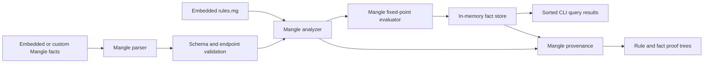

# Architecture

## Data flow

## Responsibilities

| Component | Responsibility |
| --- | --- |
| `cmd/kg` | Flags, file input, commands, output and exit status |
| `internal/graph/graph.go` | Input contract, Mangle integration, queries and explanations |
| `internal/graph/rules.mg` | Domain semantics and recursive closure |
| `internal/graph/technologies.mg` | Embedded demonstration facts |
| `*_test.go` | Behavioral, graph-oracle, provenance and CLI tests |

`parse.Unit` parses both source files. The loader validates the data AST before combining it with trusted rules. The parser's implicit unnamed package declaration is permitted; user declarations are rejected. Checking every argument's AST type prevents rules or query fragments from being smuggled through technology names. Query names are looked up among declared technologies and passed as AST constants, never interpolated into Mangle source.

`analysis.AnalyzeOneUnit` analyzes the combined program. `engine.EvalProgram` materializes facts into `factstore.SimpleInMemoryStore` using Mangle's semi-naive bottom-up evaluator. Queries retrieve inferred predicates from this store; there is no production Go implementation of transitive closure.

## Relationship semantics

`prerequisite(T, P)` means T directly requires P in the supplied model. `depends_on(T, P)` holds if a path of at least one edge leads from T to P. Direct edges seed the closure; the recursive rule extends it. Duplicate facts have set semantics.

With N technologies, the closure has at most N² distinct ordered pairs. Recursion cannot create fresh names. Evaluation reaches a fixed point even with cycles. A cycle derives self-dependency, which is useful evidence of a circular prerequisite model. `impacted_by(P, T)` reverses dependency direction and explicitly excludes T = P.

## Explanations

`provenance.Explain` reconstructs proofs from the evaluated store and analyzed rules. It exposes the goal, rule text, bindings, premises, and extensional database (EDB) leaves. `provenance.Print` renders these trees. Impact explanations include the reverse-relation rule and then the dependency derivation.

The application requests at most three proofs at depth 64. This bounds returned alternatives and depth, not a global CPU or memory budget. Partial proofs are labeled by the upstream renderer. The selected proof is not promised to be a shortest path, and the output is not a complete enumeration of every possible derivation. The API detects recursive proof cycles; non-cyclic support for a cyclic relationship can still be explained.

An absent result means it is not derivable from this snapshot. It is not evidence of universal independence outside the model.

## Design choices and limits

- **Fixed rules, replaceable facts:** a small, explicit data contract keeps CLI semantics and explanations reliable. Extend the embedded rules and tests together when adding domain concepts.
- **Embedding:** built binaries work from any directory without finding runtime asset files.
- **In-memory snapshots:** easy to reproduce, with no service setup. Changing data requires reevaluation.
- **Stable query ordering:** facts and technology lists are sorted before display; proof rendering belongs to the pinned upstream implementation.
- **No service or concurrency layer:** the CLI evaluates once and reads sequentially. No concurrent mutation API is exposed.
- **Local trusted files:** input size and evaluation time are not capped. This is not a sandbox for hostile data or a large-graph service.
- **Portable module name:** `mangle-knowledge-graph` permits local builds without inventing a GitHub owner. Change it and internal imports together if a public import path is needed after publication approval.

## Testing strategy

The production implementation delegates recursion to Mangle. Tests independently compute reachability for every directed three-node graph without self-edges and compare both query directions. Separate cases cover self-loops, duplicate edges and multi-step sample dependencies. A diamond graph requires two alternative proofs whose leaf facts exist in the source store. CLI tests exercise commands, custom input, help, and failure paths.
